<div align="center">

# Hey, I'm Harsimran 👋

**🛡️ Defend systems. 🧠 Follow the evidence. ⚙️ Automate the boring bits.**

<a href="https://harsim.ca">
  
</a>


<br><br>

<a href="https://harsim.ca"></a>
<a href="https://www.linkedin.com/in/harsimransidhu/"></a>
<a href="https://hub.docker.com/u/pkvirus"></a>

<br><br>

[🧑‍💻 About me](#-the-human-behind-the-terminal) · [🚀 Projects](#-things-ive-built) · [🏠 Homelab](#-meanwhile-in-the-homelab) · [🧰 Toolkit](#-my-toolkit) · [🐍 Snake](#-one-more-commit)

</div>

---

## 🧑‍💻 The human behind the terminal


I'm **Harsimran Sidhu**, a cybersecurity analyst and developer who likes turning messy security data into useful tools, dashboards, and repeatable workflows.

- 🛡️ **On the security side:** WAF detection and tuning, endpoint investigations, and detection engineering.
- 🔭 **Building out:** cyber threat intelligence workflows with **Splunk Enterprise**.
- ⚙️ **Automating with:** Python, Docker, and Ansible.
- 🌱 **Exploring:** OpenCTI and better ways to turn threat data into actionable intelligence.
- 🏠 **After the dashboards:** homelab experiments, monitoring stacks, and Raspberry Pi projects.
- 💬 **Talk to me about:** SOC automation, Splunk, incident response, or open source.

> If there's a repetitive task, there's probably a script waiting to happen.

<br clear="both" />

---

## 🚀 Things I've built

### 🛰️ SwiftIOC — from threat feeds to investigation

Collect and normalize indicators of compromise and vulnerability reports, then explore them in a browser dashboard with source evidence and downloadable feeds.

**Python · Threat intelligence · Analyst workflows**

[🔎 Try the live dashboard](https://harsim.ca/SwiftIOC-Automated-Threat-Intelligence-Collector/) · [🧑‍💻 Explore the code](https://github.com/PKHarsimran/SwiftIOC-Automated-Threat-Intelligence-Collector)

### 🌐 Website Downloader CLI — take the web offline

Create browsable offline mirrors of websites you're authorized to archive. Rewrites links and assets, supports incremental updates, and offers optional JavaScript rendering with Playwright.

**Python · Web archiving · Playwright**

[📖 Read the guide](https://github.com/PKHarsimran/website-downloader/wiki) · [🧑‍💻 Explore the code](https://github.com/PKHarsimran/website-downloader)

<div align="center">
  <a href="https://github.com/PKHarsimran/SwiftIOC-Automated-Threat-Intelligence-Collector"></a>
  <a href="https://github.com/PKHarsimran/website-downloader"></a>
</div>

### 🕵️ IOC Inspector — give suspicious documents a closer look

Triage PDFs and Office documents with static analysis, IOC extraction, and optional threat enrichment. Export findings in Markdown, JSON, or CSV for investigation notes and downstream workflows.

**Python · Document analysis · Structured reporting**

[🧑‍💻 Explore IOC Inspector](https://github.com/PKHarsimran/IOC-Inspector)

---

## 🏠 Meanwhile, in the homelab...

```text
homelab/
├── 📡 collect      Fluentd + MQTT
├── 🗃️ store        InfluxDB
├── 📊 visualize    Grafana
├── ⚙️ automate     Ansible + Semaphore
└── 🥧 experiment   Raspberry Pi + whatever comes next
```

**The loop:** build something → watch the logs → learn something → automate it → repeat. 🔁

---

## 🧰 My toolkit

### 🐍 Code & scripts

<p>


</p>

### 🛡️ Security & detection

<p>


</p>

### ⚙️ Automation & observability

<p>


</p>

---

## 📊 The commit log

<div align="center">
  
  
</div>

## 🐍 One more commit...

<div align="center">

*Even the snake has a backlog.*

<picture>
  <source media="(prefers-color-scheme: dark)" srcset="https://raw.githubusercontent.com/PKHarsimran/PKHarsimran/output/github-contribution-grid-snake-dark.svg">
  
</picture>

</div>

---

<div align="center">

**Build. Break. Learn. Automate. Repeat.**

⚡ *"You have greatness within you."*

[Say hello on LinkedIn](https://www.linkedin.com/in/harsimransidhu/) · [Explore my corner of the web](https://harsim.ca)

</div>
