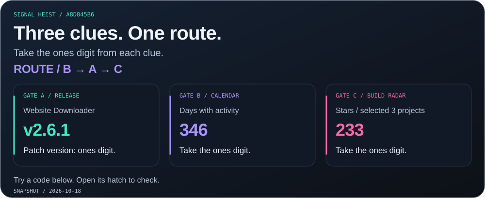
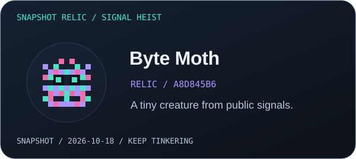

<a href="https://harsim.ca">
<picture>
  <source media="(max-width: 600px)" srcset="./profile/studio-orbit-hero-mobile.svg">
  
</picture>
</a>

<!-- buttons:hero:start -->

  
  

<!-- buttons:hero:end -->

<!-- buttons:navigation:start -->

  
  
  

<!-- buttons:navigation:end -->

I work in **cybersecurity** and build tools that make investigations clearer and repetitive work shorter. Off the clock, I connect the dots in my **Zima homelab**. The robot has other plans. 🛠️

## Selected builds

**Pick a side quest:** [Investigate threat feeds](#user-content-01--swiftioc) · [Inspect a document](#user-content-02--ioc-inspector) · [Save a site offline](#user-content-03--website-downloader)

### 01 / SwiftIOC

<a href="https://github.com/PKHarsimran/SwiftIOC-Automated-Threat-Intelligence-Collector">
<picture>
  <source media="(max-width: 600px)" srcset="./profile/studio-swiftioc-motion-mobile.svg">
  
</picture>
</a>

**Follow an indicator back to its source.** A Python pipeline collects threat feeds and vulnerability reports; the dashboard keeps their evidence in view.

<!-- buttons:swift:start -->

  
  

<!-- buttons:swift:end -->

<picture>
  <source media="(max-width: 600px)" srcset="./profile/drawers/evidence-mobile.svg">
  
</picture>

<a href="./profile/intel-conveyor.md">
<picture>
  <source media="(max-width: 600px)" srcset="./profile/intel-conveyor-mobile.svg">
  
</picture>
</a>

Real feed counts, illustrated from a saved collection snapshot. [Read the data](./profile/intel-conveyor.md).

**12 seconds at the evidence desk**

<picture>
  <source media="(prefers-reduced-motion: reduce)" srcset="./profile/swift-demo.webp">
  
</picture>

Recorded October 17, 2026. Open the dashboard for current records.

### 02 / IOC Inspector

<a href="https://github.com/PKHarsimran/IOC-Inspector">
<picture>
  <source media="(max-width: 600px)" srcset="./profile/studio-inspector-motion-mobile.svg">
  
</picture>
</a>

**Find the clues in a suspicious document.** Inspect PDFs and Office files, extract IOCs, and export a readable report. Optional threat enrichment adds context.

<!-- buttons:inspector:start -->

  
  

<!-- buttons:inspector:end -->

<picture>
  <source media="(max-width: 600px)" srcset="./profile/drawers/case-mobile.svg">
  
</picture>

A harmless training PDF, a few hidden clues, and the real scanner. What can you spot?

<picture>
  <source media="(max-width: 600px)" srcset="./profile/case-file-mobile.svg">
  
</picture>

<strong>🔎 Open the evidence envelope</strong> · reveal the findings

[Read the report](./profile/case-report.md) · [See the extracted data](./profile/case-report.json)

<strong>🎬 Replay the investigation</strong> · real CLI run

<picture>
  <source media="(prefers-reduced-motion: reduce)" srcset="./profile/inspector-demo.webp">
  
</picture>

A real CLI run against an owned training file. [How it was recorded](./profile/demo-provenance.json).

### 03 / Website Downloader

<a href="https://github.com/PKHarsimran/website-downloader">
<picture>
  <source media="(max-width: 600px)" srcset="./profile/studio-downloader-motion-mobile.svg">
  
</picture>
</a>

**Take a little piece of the web offline.** Save pages and assets with working local links. Add Playwright rendering when a page needs JavaScript.

<!-- buttons:downloader:start -->

  
  

<!-- buttons:downloader:end -->

<picture>
  <source media="(max-width: 600px)" srcset="./profile/drawers/offline-mobile.svg">
  
</picture>

<picture>
  <source media="(prefers-reduced-motion: reduce)" srcset="./profile/downloader-demo.webp">
  
</picture>

A real CLI run: save an owned test site, stop its server, then check the offline copy. [Run results](./profile/downloader-demo.json).

## Inside the lab

My **Zima homelab** is where side projects become everyday tools. **Docker Compose** connects media requests, libraries, photos, dashboards, and monitoring.

<picture>
  <source media="(max-width: 600px)" srcset="./profile/homelab-flow-motion-mobile.svg">
  
</picture>

The real service cast, with illustrated handoffs. [Public service manifest](./profile/lab-services.json).

<picture>
  <source media="(max-width: 600px)" srcset="./profile/drawers/crew-mobile.svg">
  
</picture>

| Area | Services |
| :--- | :--- |
| Media & automation | Jellyfin, Jellyseerr, Radarr, Sonarr, Prowlarr, Bazarr |
| Downloads | Transmission, Gluetun |
| Photos | PhotoPrism |
| Books & audio | Shelfmark, Audiobookshelf |
| Operations | Homepage, Portainer, custom flow dashboards |
| Monitoring | Uptime Kuma, Glances, Dozzle, ntfy |

**Next checkpoint:** turn the lab lessons into a **modular Compose starter kit** that someone else can bring online by following the docs. ⚙️

## Toolkit

<picture>
  <source media="(max-width: 600px)" srcset="./profile/mission-toolkit-icons-mobile.svg">
  
</picture>

<!-- buttons:containers:start -->

  

<!-- buttons:containers:end -->

## After hours: the arcade

The tools do useful work. Pixel handles the side quests. Follow the bot, crack today’s code, or find the secret terminal.

<a href="https://harsim.ca/lab/">
<picture>
  <source media="(max-width: 600px)" srcset="./profile/pixel-portal-mobile.svg">
  
</picture>
</a>

<!-- buttons:live-lab:start -->

  

<!-- buttons:live-lab:end -->

Step inside, press <code>/</code>, and ask Pixel for <code>help</code>. The terminal, saved progress, and collectible patches live in the lab.

<picture>
  <source media="(max-width: 600px)" srcset="./profile/contribution-evidence-run-mobile.svg">
  
</picture>

Real GitHub activity; an illustrated bot adventure. Totals include automation and publicly shared private activity. [Daily snapshot](./profile/contribution-calendar.json).

<!-- arcade-lab:start -->

<picture>
  <source media="(max-width: 600px)" srcset="./profile/drawers/heist-mobile.svg">
  
</picture>

<picture>
  <source media="(max-width: 600px)" srcset="./profile/arcade/heist-a8d845b69ffe7ca4-mobile.svg">
  
</picture>

**Three clues → one code → a tiny creature.** Take each gate’s digit, follow the printed route, and open a code hatch.

<strong>🔐 Hatch 01</strong> · <code>750</code>

↺ **Decoy hatch.** Check the ones digits and the route order. Another hatch awaits.

<strong>🔐 Hatch 02</strong> · <code>613</code>

🔓 **Signal recovered.** B → A → C gives **613**.

| Gate | Clue | Digit |
| --- | --- | ---: |
| A | Website Downloader: v2.6.1 | 1 |
| B | Days with activity: 346 | 6 |
| C | Stars / selected 3 projects: 233 | 3 |

**Next side quest:** [Explore Website Downloader](https://github.com/PKHarsimran/website-downloader) — the real tool behind gate A.

[Open your creature art](./profile/arcade/relic-a8d845b69ffe7ca4.svg)

<strong>🔐 Hatch 03</strong> · <code>076</code>

↺ **Decoy hatch.** Check the ones digits and the route order. Another hatch awaits.

<strong>⏪ Checkpoint rewind</strong> · what changed since last time?

Snapshots: **2026-10-18 19:57:06** → **2026-10-18 20:03:58** UTC. Comparing the three selected public projects.

**Quiet checkpoint.** No changes in releases, CI, stars, or latest commit times.

A fresh puzzle from public signals each day. [Snapshot & creature fingerprint](./profile/arcade-lab.json).

<!-- arcade-lab:end -->

<picture>
  <source media="(max-width: 600px)" srcset="./profile/drawers/snake-mobile.svg">
  
</picture>

<picture>
  <source media="(prefers-color-scheme: dark)" srcset="https://raw.githubusercontent.com/PKHarsimran/PKHarsimran/output/github-contribution-grid-snake-dark.svg">
  
</picture>

<picture>
  <source media="(max-width: 600px)" srcset="./profile/drawers/radar-mobile.svg">
  
</picture>

<a href="./profile/public-pulse.md">
<picture>
  <source media="(max-width: 600px)" srcset="./profile/public-pulse-mobile.svg">
  
</picture>
</a>

<!-- buttons:radar:start -->

  
  

<!-- buttons:radar:end -->

<strong>🏅 Browse the patch cabinet</strong> · earned by real releases

<a href="./profile/release-patches.md">
<picture>
  <source media="(max-width: 600px)" srcset="./profile/release-patches-mobile.svg">
  
</picture>
</a>

[Open the release log](./profile/release-patches.md)

<picture>
  <source media="(max-width: 600px)" srcset="./profile/drawers/backstage-mobile.svg">
  
</picture>

GitHub Actions refresh the public project signals and daily puzzle. Case files and CLI demos refresh weekly or when their recipes change. The artwork keeps its source snapshots close.

[Arcade workflow](https://github.com/PKHarsimran/PKHarsimran/actions/workflows/profile-lab.yml) · [Demo workflow](https://github.com/PKHarsimran/PKHarsimran/actions/workflows/living-profile.yml) · [Make your own exhibits](./demos/README.md)

<!-- buttons:return:start -->

  

<!-- buttons:return:end -->

<!-- visitors:start -->
<picture>
  <source media="(max-width: 600px)" srcset="./profile/studio-guestbook-motion-mobile.svg" />
  
</picture>

  

Page hits, not unique visitors · <a href="https://github.com/silentsoft/hits#statistics">About the counter</a>
<!-- visitors:end -->

<!-- buttons:footer:start -->

  

<!-- buttons:footer:end -->

Build with curiosity. Leave something useful behind.

