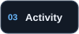
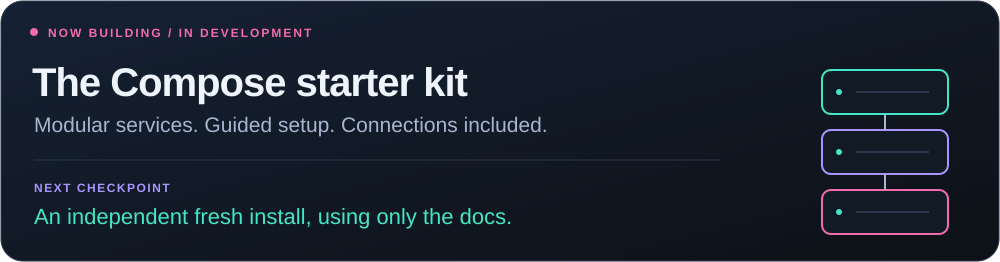
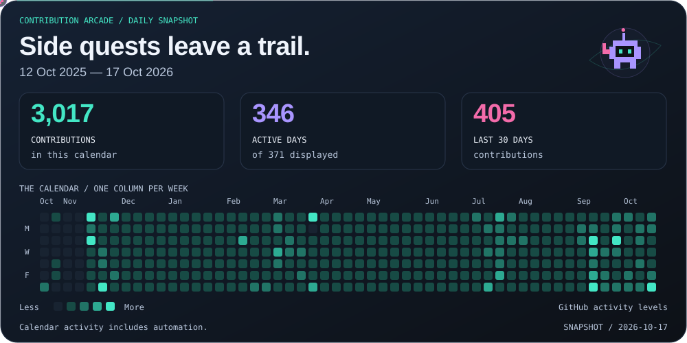

<a href="https://harsim.ca">
<picture>
  <source media="(max-width: 600px)" srcset="./profile/studio-orbit-hero-mobile.svg">
  
</picture>
</a>

<a href="https://harsim.ca">
<picture>
  <source media="(max-width: 600px)" srcset="./profile/mission-typing-mobile.svg">
  
</picture>
</a>

<!-- buttons:hero:start -->

  
  

<!-- buttons:hero:end -->

<!-- buttons:navigation:start -->

  
  
  

<!-- buttons:navigation:end -->

I work in **cybersecurity** and build tools for clearer investigations, better dashboards, and fewer repetitive steps. The side quests usually end up in my **Zima homelab**.

<strong>🧠 Behind the builds / current focus</strong>

| Station | What I'm working on |
| :--- | :--- |
| 🛡️ **Defend** | WAF tuning, endpoint investigations, and detection engineering |
| 🔭 **Investigate** | Threat intelligence with **Splunk Enterprise**, exploring **OpenCTI** |
| 🏠 **Build** | A **Docker Compose** home server for media, photos, books, and monitoring |

> My favourite kind of side project? A repetitive task that doesn't need to be repetitive anymore.

## Selected builds

**Pick a side quest:** [Investigate threat feeds](#user-content-01--swiftioc) · [Inspect a document](#user-content-02--ioc-inspector) · [Save a site offline](#user-content-03--website-downloader)

### 01 / SwiftIOC

<a href="https://github.com/PKHarsimran/SwiftIOC-Automated-Threat-Intelligence-Collector">
<picture>
  <source media="(max-width: 600px)" srcset="./profile/studio-swiftioc-motion-mobile.svg">
  
</picture>
</a>

**Collect → normalize → investigate.** A Python pipeline turns IOC feeds and vulnerability reports into source-aware records. The browser dashboard brings the evidence together for review and export.

<!-- buttons:swift:start -->

  
  

<!-- buttons:swift:end -->

<a href="./profile/intel-conveyor.md">
<picture>
  <source media="(max-width: 600px)" srcset="./profile/intel-conveyor-mobile.svg">
  
</picture>
</a>

Real collection data, illustrated. Counts describe the retained feed and one collection interval. [Open the snapshot](./profile/intel-conveyor.md).

<strong>🎬 Watch a 12-second evidence review</strong>

<picture>
  <source media="(prefers-reduced-motion: reduce)" srcset="./profile/swift-demo.webp">
  
</picture>

Recorded from the public dashboard on October 17, 2026. The displayed records are a snapshot; use the live dashboard for current data.

<strong>🧠 Build story: keep the evidence attached</strong>

- **Problem:** scattered feeds make it hard to understand where an indicator came from or what a vulnerability report actually establishes.
- **Built:** a Python collection and normalization pipeline, source-aware records, downloadable feeds, and a browser workspace for investigation.
- **Design takeaway:** keep provenance visible and separate indicators from vulnerability evidence. A score helps order review; it doesn't establish compromise.

[Explore how SwiftIOC works ↗](https://github.com/PKHarsimran/SwiftIOC-Automated-Threat-Intelligence-Collector#how-the-pieces-fit)

### 02 / IOC Inspector

<a href="https://github.com/PKHarsimran/IOC-Inspector">
<picture>
  <source media="(max-width: 600px)" srcset="./profile/studio-inspector-motion-mobile.svg">
  
</picture>
</a>

**Inspect → extract → report.** Triage PDFs and Office files with static analysis, IOC extraction, and optional threat enrichment. Export the findings as Markdown, JSON, or CSV.

<!-- buttons:inspector:start -->

  
  

<!-- buttons:inspector:end -->

<picture>
  <source media="(max-width: 600px)" srcset="./profile/case-file-mobile.svg">
  
</picture>

<strong>🕵️ Reveal the findings</strong>

[Read the case file](./profile/case-report.md) · [Raw tool findings](./profile/case-report.json) · [Fixture recipe](./demos/cases.json)

<strong>🎬 Watch the released scanner work the case</strong>

<picture>
  <source media="(prefers-reduced-motion: reduce)" srcset="./profile/inspector-demo.webp">
  
</picture>

The workflow records a real CLI execution. Reserved example domains and documentation IPs keep the fixture harmless. [Recording provenance](./profile/demo-provenance.json).

### 03 / Website Downloader

<a href="https://github.com/PKHarsimran/website-downloader">
<picture>
  <source media="(max-width: 600px)" srcset="./profile/studio-downloader-motion-mobile.svg">
  
</picture>
</a>

**Capture → rewrite → browse offline.** Mirror websites, bring their assets along, and rewrite links for offline browsing. Update existing copies or use optional Playwright rendering for pages that need JavaScript.

<!-- buttons:downloader:start -->

  
  

<!-- buttons:downloader:end -->

<strong>🎬 Watch the CLI turn a site into an offline copy</strong>

<picture>
  <source media="(prefers-reduced-motion: reduce)" srcset="./profile/downloader-demo.webp">
  
</picture>

Automatically recorded from the released CLI against an owned local site. The source server stops before the offline links are checked. [Run results](./profile/downloader-demo.json) · [Recording provenance](./profile/demo-provenance.json).

<!-- buttons:return:start -->

  

<!-- buttons:return:end -->

## Inside the lab

My **Zima homelab** runs on **Docker Compose**. Media, photos, books, dashboards, and monitoring share a home; I build the workflows and automation that connect them.

<picture>
  <source media="(max-width: 600px)" srcset="./profile/homelab-flow-motion-mobile.svg">
  
</picture>

Animated from the [public service manifest](./profile/lab-services.json). Illustrated handoffs; the service inventory below has the full cast.

- 🎬 **Connect the workflow:** requests → library automation → VPN-routed downloads → Jellyfin playback.
- 🖼️ **Bring the libraries together:** photo management, books, and audiobooks in one self-hosted stack.
- 🧭 **See what's happening:** custom Homepage and flow dashboards, health checks, logs, and notifications.

<strong>🧩 Open the service inventory</strong>

| Area | Services |
| :--- | :--- |
| Media & automation | Jellyfin, Jellyseerr, Radarr, Sonarr, Prowlarr, Bazarr |
| Downloads | Transmission, Gluetun |
| Photos | PhotoPrism |
| Books & audio | Shelfmark, Audiobookshelf |
| Operations | Homepage, Portainer, custom flow dashboards |
| Monitoring | Uptime Kuma, Glances, Dozzle, ntfy |

**Current side quest:** make the stack easier to run, recover, and eventually share. ⚙️

<strong>🧠 Build story: a server, not just a list of containers</strong>

- **Problem:** a collection of running services still leaves requests, downloads, imports, libraries, and troubleshooting disconnected.
- **Built:** a Compose-based home server connecting media workflows, photo and book libraries, custom dashboards, health checks, logs, and notifications.
- **Design takeaway:** the useful work is in the connections: storage paths, permissions, service handoffs, and understandable recovery. More containers alone don't make a better server.

<!-- buttons:return:start -->

  

<!-- buttons:return:end -->

## On the workbench

<picture>
  <source media="(max-width: 600px)" srcset="./profile/mission-now-mobile.svg" />
  
</picture>

Turning lessons from the Zima lab into a **modular Compose starter kit**. The test: someone else can follow the docs, choose their services, and bring the stack online.

## Toolkit

<picture>
  <source media="(max-width: 600px)" srcset="./profile/mission-toolkit-icons-mobile.svg">
  
</picture>

<!-- buttons:containers:start -->

  

<!-- buttons:containers:end -->

## Build signals

### Public build radar

<a href="./profile/public-pulse.md">
<picture>
  <source media="(max-width: 600px)" srcset="./profile/public-pulse-mobile.svg">
  
</picture>
</a>

<!-- buttons:radar:start -->

  
  

<!-- buttons:radar:end -->

<strong>💓 Open live checks & release links</strong>

| Public project | Checks | Latest release |
| :--- | :--- | :--- |
| [SwiftIOC](https://github.com/PKHarsimran/SwiftIOC-Automated-Threat-Intelligence-Collector) |  |  |
| [IOC Inspector](https://github.com/PKHarsimran/IOC-Inspector) |  |  |
| [Website Downloader](https://github.com/PKHarsimran/website-downloader) |  |  |

Badges may be cached; open one for the underlying workflow or release.

<strong>🏅 Open the release mission-patch cabinet</strong>

<a href="./profile/release-patches.md">
<picture>
  <source media="(max-width: 600px)" srcset="./profile/release-patches-mobile.svg">
  
</picture>
</a>

[Open the release log](./profile/release-patches.md)

### Contribution arcade

<a href="./profile/contribution-calendar.json">
<picture>
  <source media="(max-width: 600px)" srcset="./profile/contribution-arcade-mobile.svg">
  
</picture>
</a>

One square, one day. Colour follows GitHub's activity levels. Calendar activity includes automation and any private activity shared publicly. [Read the daily snapshot](./profile/contribution-calendar.json).

<strong>🐍 Bonus round / let the snake loose</strong>

<picture>
  <source media="(prefers-color-scheme: dark)" srcset="https://raw.githubusercontent.com/PKHarsimran/PKHarsimran/output/github-contribution-grid-snake-dark.svg">
  
</picture>

<strong>📊 Extra stats & language mix</strong>

<picture>
  <source media="(max-width: 600px)" srcset="./profile/activity-summary-mobile.svg">
  
</picture>

<strong>⚙️ How the profile builds itself</strong>

- **Daily:** read public SwiftIOC diagnostics and public release metadata; regenerate the conveyor, homelab flow and release patches.
- **Weekly, or when releases/recipes change:** rotate the harmless case, run the released CLIs, verify their output, and record fresh demo reels.
- **Every build:** keep collection timestamps and source provenance, support reduced motion, and publish only after the checks pass.

[Watch the workflow ↗](https://github.com/PKHarsimran/PKHarsimran/actions/workflows/living-profile.yml) · [Reproduce the exhibits](./demos/README.md)

<!-- buttons:return:start -->

  

<!-- buttons:return:end -->

<!-- visitors:start -->
<picture>
  <source media="(max-width: 600px)" srcset="./profile/studio-guestbook-motion-mobile.svg" />
  
</picture>

  

Page hits, not unique visitors · <a href="https://github.com/silentsoft/hits#statistics">About the counter</a>
<!-- visitors:end -->

**Have a useful problem to solve? Let’s talk.**

<!-- buttons:footer:start -->

  

<!-- buttons:footer:end -->

Build with curiosity. Leave something useful behind.

