**Cybersecurity analyst · Open-source builder · Homelab tinkerer**

[Website ↗](https://harsim.ca) · [LinkedIn ↗](https://www.linkedin.com/in/harsimransidhu/) · [Docker Hub ↗](https://hub.docker.com/u/pkvirus)

[👋 Operator](#-operator-profile) · [🚀 Projects](#-selected-builds) · [🏠 Homelab](#-inside-the-lab) · [🚧 Now building](#-now-building) · [🧰 Toolkit](#-toolkit) · [📊 Activity](#-activity-log)

## 👋 Operator profile

I'm **Harsimran Sidhu**. I work in cybersecurity and build tools that turn messy security data into something useful: clearer investigations, better dashboards, and fewer repetitive steps.

| Station | What I'm working on |
| :--- | :--- |
| 🛡️ **Defend** | WAF tuning, endpoint investigations, and detection engineering |
| 🔭 **Investigate** | Threat intelligence with **Splunk Enterprise**, exploring **OpenCTI** |
| 🏠 **Build** | A **Docker Compose** home server for media, photos, books, and monitoring |

> My favourite kind of side project? A repetitive task that doesn't need to be repetitive anymore.

## 🚀 Selected builds

### 📡 Public build radar

[Read the snapshot](./profile/public-pulse.md) · [Watch the generator run ↗](https://github.com/PKHarsimran/PKHarsimran/actions/workflows/profile-lab.yml)

<strong>💓 Open live checks & release links</strong>

| Public project | Checks | Latest release |
| :--- | :--- | :--- |
| [SwiftIOC](https://github.com/PKHarsimran/SwiftIOC-Automated-Threat-Intelligence-Collector) |  |  |
| [IOC Inspector](https://github.com/PKHarsimran/IOC-Inspector) |  |  |
| [Website Downloader](https://github.com/PKHarsimran/website-downloader) |  |  |

Badges may be cached; open one for the underlying workflow or release.

### 01 / SwiftIOC

**Threat intelligence you can trace back to the source.** A Python collector normalizes IOCs and vulnerability reports; the browser dashboard brings the evidence together for investigation and export.

[🛰️ Open dashboard ↗](https://harsim.ca/SwiftIOC-Automated-Threat-Intelligence-Collector/) · [Source ↗](https://github.com/PKHarsimran/SwiftIOC-Automated-Threat-Intelligence-Collector)

<strong>🎬 Watch a 12-second evidence review</strong>

<picture>
  <source media="(prefers-reduced-motion: reduce)" srcset="./profile/swift-demo.webp">
  
</picture>

Recorded from the public dashboard on October 17, 2026. The displayed records are a snapshot; use the live dashboard for current data.

<strong>🧠 Build story: keep the evidence attached</strong>

- **Problem:** scattered feeds make it hard to understand where an indicator came from or what a vulnerability report actually establishes.
- **Built:** a Python collection and normalization pipeline, source-aware records, downloadable feeds, and a browser workspace for investigation.
- **Design takeaway:** keep provenance visible and separate indicators from vulnerability evidence. A score helps order review; it doesn't establish compromise.

[Explore how SwiftIOC works ↗](https://github.com/PKHarsimran/SwiftIOC-Automated-Threat-Intelligence-Collector#how-the-pieces-fit)

### 02 / IOC Inspector

**Suspicious documents, useful answers.** Triage PDFs and Office files with static analysis, IOC extraction, and optional threat enrichment. Export Markdown, JSON, or CSV for the next step of the investigation.

[Source ↗](https://github.com/PKHarsimran/IOC-Inspector)

### 03 / Website Downloader

**An offline copy you can actually browse.** Mirror websites you're authorized to archive, rewrite links and assets, and update existing copies. Optional Playwright rendering handles pages that need JavaScript.

[📖 Field guide ↗](https://github.com/PKHarsimran/website-downloader/wiki) · [Source ↗](https://github.com/PKHarsimran/website-downloader)

<strong>🎬 Watch the CLI turn a site into an offline copy</strong>

<picture>
  <source media="(prefers-reduced-motion: reduce)" srcset="./profile/cli-demo.webp">
  
</picture>

A replay of real CLI output, followed by the generated mirror. Recorded October 17, 2026, using an owned local fixture; the localhost address is part of the demo.

## 🏠 Inside the lab

My **Zima homelab** brings media, photos, books, and everyday self-hosting together with **Docker Compose**. I've built the connections, dashboards, and automation around the services to make the whole stack easier to run.

- 🎬 **Connect the workflow:** requests → library automation → VPN-routed downloads → Jellyfin playback.
- 🖼️ **Bring the libraries together:** photo management, books, and audiobooks in one self-hosted stack.
- 🧭 **See what's happening:** custom Homepage and flow dashboards, health checks, logs, and notifications.

<strong>🧩 Open the service inventory</strong>

| Area | Services |
| :--- | :--- |
| Media & automation | Jellyfin, Jellyseerr, Radarr, Sonarr, Prowlarr, Bazarr |
| Downloads | Transmission, Gluetun |
| Photos | PhotoPrism |
| Books & audio | Shelfmark, Audiobookshelf |
| Operations | Homepage, Portainer, custom flow dashboards |
| Monitoring | Uptime Kuma, Glances, Dozzle, ntfy |

**The fun part:** teaching the containers to work together, then automating the bits in between. ⚙️

<strong>🧠 Build story: a server, not just a list of containers</strong>

- **Problem:** a collection of running services still leaves requests, downloads, imports, libraries, and troubleshooting disconnected.
- **Built:** a Compose-based home server connecting media workflows, photo and book libraries, custom dashboards, health checks, logs, and notifications.
- **Design takeaway:** the useful work is in the connections: storage paths, permissions, service handoffs, and understandable recovery. More containers alone don't make a better server.

## 🚧 Now building

Turning lessons from the Zima lab into a **modular Compose starter kit**. The test: someone else can follow the docs, choose their services, and bring the stack online.

## 🧰 Toolkit

<picture>
  <source media="(max-width: 600px)" srcset="./profile/mission-toolkit-mobile.svg">
  
</picture>

## 📊 Activity log

  
  

### 🐍 Even the snake has a backlog

<picture>
  <source media="(prefers-color-scheme: dark)" srcset="https://raw.githubusercontent.com/PKHarsimran/PKHarsimran/output/github-contribution-grid-snake-dark.svg">
  
</picture>

<strong>🚀 Launch contribution patrol</strong>

Every square is a day; colour is GitHub's activity level. Generated daily from the [public calendar](https://github.com/PKHarsimran). [Read the calendar snapshot](./profile/contribution-patrol.json).

---

**Security workflows, useful tools, or a self-hosting rabbit hole? Let's talk.**

[Say hello on LinkedIn ↗](https://www.linkedin.com/in/harsimransidhu/) · [Explore harsim.ca ↗](https://harsim.ca)

Build with curiosity. Leave something useful behind.

