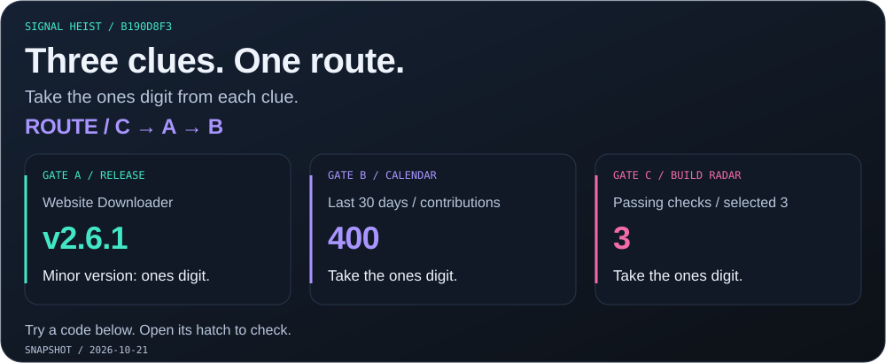
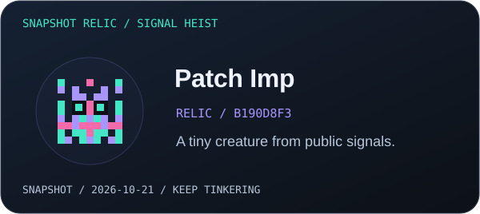

<a href="https://harsim.ca">
<picture>
  <source media="(max-width: 600px)" srcset="./profile/studio-orbit-hero-mobile.svg?v=identity-motion-4">
  
</picture>
</a>

<!-- buttons:hero:start -->

  
  

<!-- buttons:hero:end -->

<!-- buttons:navigation:start -->

  
  
  

<!-- buttons:navigation:end -->

I work in **cybersecurity** and build tools that make investigations clearer and repetitive work shorter. Off the clock, I connect the dots in my **Zima homelab**. The robot has other plans. 🛠️

New here? <a href="./FIELD-GUIDE.md">Open the field guide</a> for direct links to live demos, readable replays, and setup docs.

<picture><source media="(max-width: 600px)" srcset="./profile/drawers/thread-mobile.svg"></picture>

 

<picture>
  <source media="(max-width: 600px)" srcset="./profile/curiosity-thread-mobile.svg">
  
</picture>

**Choose your first stop:**

| Your mission | Follow this thread |
| :--- | :--- |
| Follow a signal | [Open the live dashboard](https://harsim.ca/SwiftIOC-Automated-Threat-Intelligence-Collector/) |
| See a tool in action | [Document investigation](./profile/inspector-demo.md) · [Offline field trip](./profile/downloader-demo.md) |
| Explore self-hosting | [Inside the Zima homelab](#user-content-homelab) |
| Bring a little chaos | [Explore the live lab](https://harsim.ca/lab/) |

## Selected builds

Three public tools: collect context, inspect the clues, and keep a useful page.

### 01 / SwiftIOC

<a href="https://github.com/PKHarsimran/SwiftIOC-Automated-Threat-Intelligence-Collector">
<picture>
  <source media="(max-width: 600px)" srcset="./profile/studio-swiftioc-motion-mobile.svg">
  
</picture>
</a>

**Follow an indicator back to its source.** A Python pipeline collects threat feeds and vulnerability reports; the dashboard keeps their evidence in view.

<!-- buttons:swift:start -->

  
  

<!-- buttons:swift:end -->

<picture><source media="(max-width: 600px)" srcset="./profile/drawers/evidence-mobile.svg"></picture>

 

<a href="./profile/intel-conveyor.md">
<picture>
  <source media="(max-width: 600px)" srcset="./profile/intel-conveyor-mobile.svg">
  
</picture>
</a>

Real feed counts, illustrated from a saved collection snapshot. <a href="./profile/intel-conveyor.md">Read the data</a>.

**12 seconds at the evidence desk**

<picture>
  <source media="(prefers-reduced-motion: reduce)" srcset="./profile/swift-demo.webp">
  
</picture>

Recorded October 17, 2026. Open the dashboard for current records.

### 02 / IOC Inspector

<a href="https://github.com/PKHarsimran/IOC-Inspector">
<picture>
  <source media="(max-width: 600px)" srcset="./profile/studio-inspector-motion-mobile.svg">
  
</picture>
</a>

**Find the clues in a suspicious document.** Inspect PDFs and Office files, extract IOCs, and export a readable report. Optional threat enrichment adds context.

<!-- buttons:inspector:start -->

  
  

<!-- buttons:inspector:end -->

<picture><source media="(max-width: 600px)" srcset="./profile/drawers/case-mobile.svg?v=case-desk-1"></picture>

 

A harmless training PDF, a few hidden clues, and the real scanner. What can you spot?

<picture>
  <source media="(max-width: 600px)" srcset="./profile/case-file-mobile.svg">
  
</picture>

<strong>🔎 Open the evidence envelope</strong>

 

[Read the report](./profile/case-report.md) · [See the extracted data](./profile/case-report.json)

<strong>🎬 Follow the clues</strong> · a three-chapter CLI replay

 

<picture>
  <source media="(prefers-reduced-motion: reduce) and (max-width: 600px)" srcset="./profile/inspector-demo-mobile.webp">
  <source media="(prefers-reduced-motion: reduce)" srcset="./profile/inspector-demo.webp">
  <source media="(max-width: 600px)" srcset="./profile/inspector-demo-mobile.gif">
  
</picture>

Run → read → prove. Findings come from the released CLI’s actual reports. <a href="./profile/inspector-demo.md">Read transcript</a> · <a href="./demos/README.md">Behind the replay</a>.

### 03 / Website Downloader

<a href="https://github.com/PKHarsimran/website-downloader">
<picture>
  <source media="(max-width: 600px)" srcset="./profile/studio-downloader-motion-mobile.svg">
  
</picture>
</a>

**Take a little piece of the web offline.** Save pages and assets with working local links. Add Playwright rendering when a page needs JavaScript.

<!-- buttons:downloader:start -->

  
  

<!-- buttons:downloader:end -->

<picture><source media="(max-width: 600px)" srcset="./profile/drawers/offline-mobile.svg"></picture>

 

<picture>
  <source media="(prefers-reduced-motion: reduce) and (max-width: 600px)" srcset="./profile/downloader-demo-mobile.webp">
  <source media="(prefers-reduced-motion: reduce)" srcset="./profile/downloader-demo.webp">
  <source media="(max-width: 600px)" srcset="./profile/downloader-demo-mobile.gif">
  
</picture>

Save → unplug → prove. Every local reference is checked with the source server off. <a href="./profile/downloader-demo.md">Read transcript</a> · <a href="./profile/downloader-demo.json">Run results</a>.

## Inside the lab

My **Zima homelab** is where side projects become everyday tools. **Docker Compose** connects media requests, libraries, photos, dashboards, and monitoring.

<picture>
  <source media="(max-width: 600px)" srcset="./profile/homelab-flow-motion-mobile.svg">
  
</picture>

The real service cast, with illustrated handoffs. <a href="./profile/lab-services.json">Public service manifest</a>.

<picture><source media="(max-width: 600px)" srcset="./profile/drawers/crew-mobile.svg"></picture>

 

| Area | Services |
| :--- | :--- |
| Media & automation | Jellyfin, Jellyseerr, Radarr, Sonarr, Prowlarr, Bazarr |
| Downloads | Transmission, Gluetun |
| Photos | PhotoPrism |
| Books & audio | Shelfmark, Audiobookshelf |
| Operations | Homepage, Portainer, custom flow dashboards |
| Monitoring | Uptime Kuma, Glances, Dozzle, ntfy |

**Next checkpoint:** turn the lab lessons into a **modular Compose starter kit** that someone else can bring online by following the docs. ⚙️

## Toolkit

<picture>
  <source media="(max-width: 600px)" srcset="./profile/mission-toolkit-icons-mobile.svg">
  
</picture>

<!-- buttons:containers:start -->

  

<!-- buttons:containers:end -->

## After hours: the arcade

The tools do useful work. Hacker Bender handles the side quests. Crack today’s code, or find the secret terminal.

<a href="https://harsim.ca/lab/">
<picture>
  <source media="(max-width: 600px)" srcset="./profile/pixel-portal-mobile.svg?v=hoodie-bender-2">
  
</picture>
</a>

<!-- buttons:live-lab:start -->

  

<!-- buttons:live-lab:end -->

Step inside, press <kbd>/</kbd>, and type <code>help</code>. The terminal, saved progress, and collectible patches live in the lab.

<picture>
  <source media="(max-width: 600px)" srcset="./profile/contribution-evidence-run-mobile.svg?v=hoodie-bender-2">
  
</picture>

Real GitHub activity; an illustrated bot adventure. Totals include automation and publicly shared private activity. <a href="./profile/contribution-calendar.json">Daily snapshot</a>.

<!-- arcade-lab:start -->

<picture><source media="(max-width: 600px)" srcset="./profile/drawers/heist-mobile.svg"></picture>

 

<picture>
  <source media="(max-width: 600px)" srcset="./profile/arcade/heist-b190d8f3ec9b0e1d-mobile.svg">
  
</picture>

**Three clues → one code → a tiny creature.** Take each gate’s digit, follow the printed route, and open a code hatch.

<strong>🔐 Hatch 01</strong> · <code>823</code>

 

↺ **Decoy hatch.** Check the ones digits and the route order. Another hatch awaits.

<strong>🔐 Hatch 02</strong> · <code>360</code>

 

🔓 **Signal recovered.** C → A → B gives **360**.

| Gate | Clue | Digit |
| --- | --- | ---: |
| A | Website Downloader: v2.6.1 | 6 |
| B | Last 30 days / contributions: 400 | 0 |
| C | Passing checks / selected 3: 3 | 3 |

**Next side quest:** [Explore Website Downloader](https://github.com/PKHarsimran/website-downloader) — the real tool behind gate A.

[Open your creature art](./profile/arcade/relic-b190d8f3ec9b0e1d.svg)

<strong>🔐 Hatch 03</strong> · <code>497</code>

 

↺ **Decoy hatch.** Check the ones digits and the route order. Another hatch awaits.

<strong>⏪ Checkpoint rewind</strong> · what changed?

 

Snapshots: **2026-10-21 01:21:35** → **2026-10-21 10:29:23** UTC. Comparing the three selected public projects.

| Project | Signal | Before | Now |
| --- | --- | --- | --- |
| SwiftIOC | latest commit at | 2026-10-20T22:54:57Z | 2026-10-21T09:42:35Z |

A fresh puzzle from public signals each day. <a href="./profile/arcade-lab.json">Snapshot &amp; creature fingerprint</a>.

<!-- arcade-lab:end -->

<picture><source media="(max-width: 600px)" srcset="./profile/drawers/snake-mobile.svg"></picture>

 

<picture>
  <source media="(prefers-color-scheme: dark)" srcset="https://raw.githubusercontent.com/PKHarsimran/PKHarsimran/output/github-contribution-grid-snake-dark.svg">
  
</picture>

<picture><source media="(max-width: 600px)" srcset="./profile/drawers/radar-mobile.svg"></picture>

 

<a href="./profile/public-pulse.md">
<picture>
  <source media="(max-width: 600px)" srcset="./profile/public-pulse-mobile.svg">
  
</picture>
</a>

<!-- buttons:radar:start -->

  
  

<!-- buttons:radar:end -->

<strong>🏅 Browse the patch cabinet</strong>

 

<a href="./profile/release-patches.md">
<picture>
  <source media="(max-width: 600px)" srcset="./profile/release-patches-mobile.svg">
  
</picture>
</a>

[Open the release log](./profile/release-patches.md)

<picture><source media="(max-width: 600px)" srcset="./profile/drawers/backstage-mobile.svg"></picture>

 

GitHub Actions refresh the public project signals and daily puzzle. Case files and CLI demos refresh weekly or when their recipes change. The artwork keeps its source snapshots close.

[Arcade workflow](https://github.com/PKHarsimran/PKHarsimran/actions/workflows/profile-lab.yml) · [Demo workflow](https://github.com/PKHarsimran/PKHarsimran/actions/workflows/living-profile.yml) · [Make your own exhibits](./demos/README.md)

<!-- visitors:start -->

<picture>
  <source media="(max-width: 600px)" srcset="./profile/studio-guestbook-motion-mobile.svg?v=checkin-desk-1" />
  
</picture>

  

Today / lifetime · approximate page hits · <a href="https://hits.sh/github.com/PKHarsimran/">Arrival log</a>

<!-- visitors:end -->

<!-- buttons:footer:start -->

  
  

<!-- buttons:footer:end -->

Build with curiosity. Leave something useful behind.

