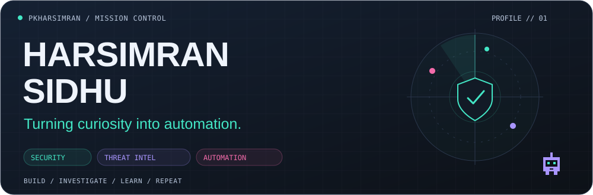
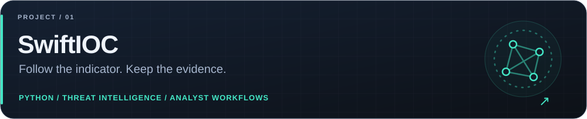
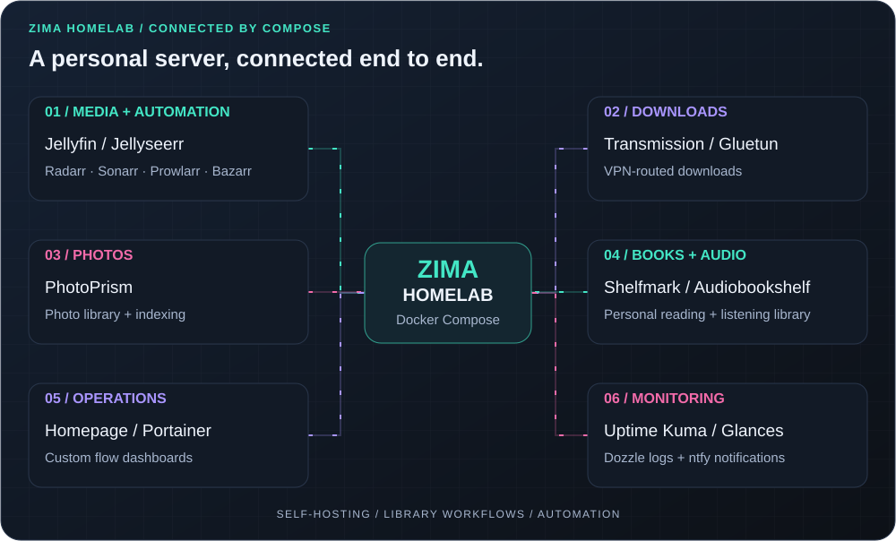

**Cybersecurity analyst · Open-source builder · Homelab tinkerer**

[Website ↗](https://harsim.ca) · [LinkedIn ↗](https://www.linkedin.com/in/harsimransidhu/) · [Docker Hub ↗](https://hub.docker.com/u/pkvirus)

[👋 Operator](#-operator-profile) · [🚀 Projects](#-selected-builds) · [🏠 Homelab](#-inside-the-lab) · [🧰 Toolkit](#-toolkit) · [📊 Activity](#-activity-log)

## 👋 Operator profile

I'm **Harsimran Sidhu**. I work in cybersecurity and build tools that turn messy security data into something useful: clearer investigations, better dashboards, and fewer repetitive steps.

| 🛡️ In the SOC | 🔭 On the workbench | 🏠 In the lab |
| :--- | :--- | :--- |
| WAF tuning, endpoint investigations, detection engineering | Threat intelligence with **Splunk Enterprise**, exploring **OpenCTI** | A **Docker Compose** home server for media, photos, books, and monitoring |

> My favourite kind of side project? A repetitive task that doesn't need to be repetitive anymore.

## 🚀 Selected builds

### 01 / SwiftIOC

A Python collector and browser dashboard for threat intelligence. Collect and normalize IOCs and vulnerability reports, inspect the source evidence, and export useful findings.

[🛰️ Launch dashboard](https://harsim.ca/SwiftIOC-Automated-Threat-Intelligence-Collector/) · [View source ↗](https://github.com/PKHarsimran/SwiftIOC-Automated-Threat-Intelligence-Collector)

### 02 / IOC Inspector

Give suspicious PDFs and Office documents a closer look with static analysis, IOC extraction, and optional threat enrichment. Export findings in Markdown, JSON, or CSV.

[🕵️ Explore IOC Inspector ↗](https://github.com/PKHarsimran/IOC-Inspector)

### 03 / Website Downloader

Create browsable offline mirrors of websites you're authorized to archive. Rewrites links and assets, supports incremental updates, and offers optional JavaScript rendering with Playwright.

[🌐 Read the field guide](https://github.com/PKHarsimran/website-downloader/wiki) · [View source ↗](https://github.com/PKHarsimran/website-downloader)

## 🏠 Inside the lab

My **Zima homelab** is a connected **Docker Compose** home server I've built for media, photos, books, and everyday self-hosting—with the dashboards and automation to keep it manageable.

- 🎬 **Connected media workflows:** requests, library automation, VPN-routed downloads, and Jellyfin playback.
- 🖼️ **Personal libraries:** photo management with PhotoPrism, plus books and audiobooks with Shelfmark and Audiobookshelf.
- 🧭 **A view of the whole stack:** custom Homepage and flow dashboards, service health checks, logs, and notifications.

I'm also turning what I've learned into a **modular Compose starter kit**, with guided setup and connected services so others can build their own home server.

**The fun part:** getting the containers to work together, then automating the bits in between. ⚙️

## 🧰 Toolkit

### 🐍 Code & scripts

### 🛡️ Security & detection

### ⚙️ Automation & observability

## 📊 Activity log

  
  

### 🐍 Even the snake has a backlog

<picture>
  <source media="(prefers-color-scheme: dark)" srcset="https://raw.githubusercontent.com/PKHarsimran/PKHarsimran/output/github-contribution-grid-snake-dark.svg">
  
</picture>

---

**Have a security workflow worth automating? Let's talk.**

[Say hello on LinkedIn ↗](https://www.linkedin.com/in/harsimransidhu/) · [Explore harsim.ca ↗](https://harsim.ca)

Build with curiosity. Leave something useful behind.

